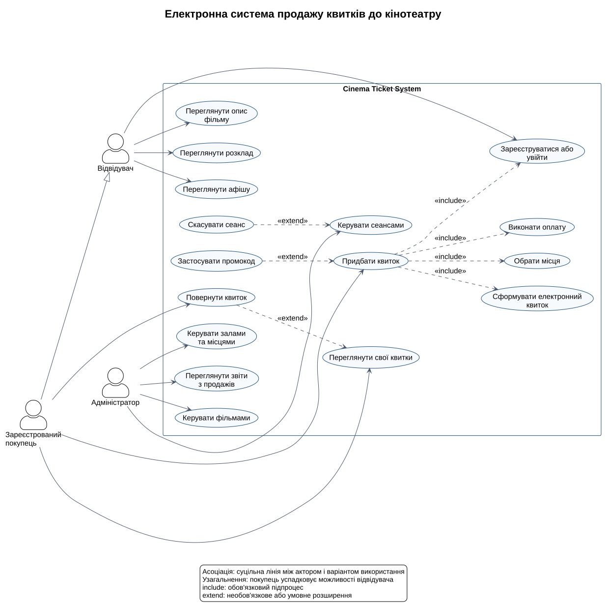
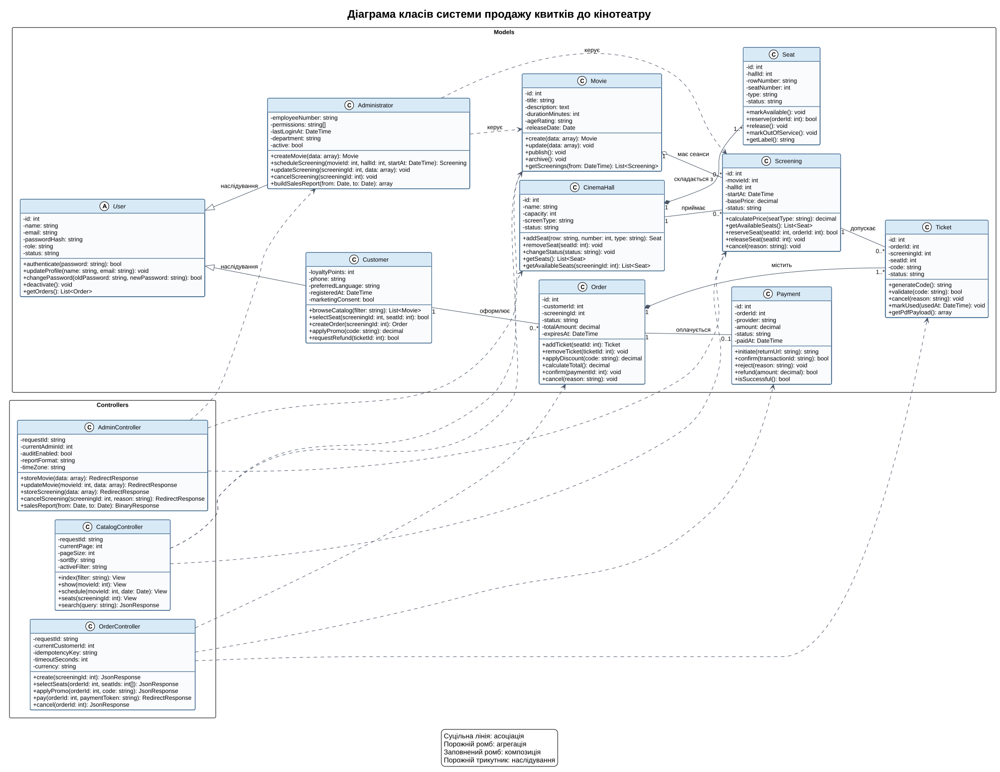

# Електронна система продажу квитків до кінотеатру

## 1 Призначення системи

Система призначена для пошуку кіносеансів, вибору місць у залі, онлайн-оплати та отримання електронного квитка. Адміністратор кінотеатру керує фільмами, залами, місцями й розкладом, а також переглядає звіти про продажі. Проєктування орієнтоване на подальшу реалізацію засобами PHP та Laravel.

## 2 Основні функції

1. Перегляд афіші, описів, вікових обмежень і тривалості фільмів.
2. Перегляд розкладу кіносеансів за датою, фільмом та залом.
3. Вибір доступних місць на інтерактивній схемі залу.
4. Тимчасове блокування вибраних місць на час оформлення замовлення.
5. Онлайн-оплата замовлення та обробка результату платежу.
6. Формування електронного квитка з унікальним кодом.
7. Перегляд історії замовлень і повернення квитка за правилами кінотеатру.
8. Керування фільмами, залами, місцями та розкладом сеансів.
9. Формування таблиць, звітів і графіків продажів.

## 3 Користувачі системи

| Користувач | Мета | Основні можливості |
|---|---|---|
| Відвідувач | Знайти фільм і зручний сеанс | Перегляд афіші, опису фільму та розкладу, реєстрація або вхід |
| Зареєстрований покупець | Придбати та керувати власними квитками | Вибір місць, оплата, отримання і повернення квитків |
| Адміністратор | Підтримувати актуальний каталог і контролювати продажі | Керування фільмами, залами, сеансами та звітами |

Зареєстрований покупець успадковує можливості відвідувача.

## 4 Архітектура MVC

Система використовує архітектурний патерн Model View Controller.

- **Model** зберігає стан і правила предметної галузі. До моделей належать `User`, `Customer`, `Administrator`, `Movie`, `CinemaHall`, `Seat`, `Screening`, `Order`, `Ticket` і `Payment`.
- **View** відображає афішу, розклад, схему залу, форму оплати, електронний квиток та адміністративні сторінки.
- **Controller** приймає HTTP-запити, перевіряє вхідні дані, викликає моделі та повертає представлення або JSON-відповідь. Основні контролери: `CatalogController`, `OrderController` і `AdminController`.

Критична бізнес-операція — резервування місця. Система повинна виконувати її в транзакції та мати унікальне обмеження для пари `screening_id` і `seat_id` серед активних квитків. Тимчасове блокування автоматично знімається після завершення часу замовлення.

## 5 Сценарії роботи

### 5.1 Перегляд афіші та розкладу

Відвідувач відкриває каталог, застосовує фільтр за датою або жанром, переглядає опис фільму та обирає зручний сеанс.

### 5.2 Купівля електронного квитка

Покупець входить до системи, обирає сеанс і вільні місця, підтверджує замовлення, виконує оплату та отримує електронний квиток.

### 5.3 Керування розкладом

Адміністратор створює картку фільму, визначає зал, дату, час і ціну сеансу. Система перевіряє, чи зал не зайнятий іншим сеансом у цей період.

### 5.4 Повернення квитка

Покупець відкриває своє замовлення та подає запит на повернення. Система перевіряє строк повернення, скасовує квиток, звільняє місце та ініціює повернення платежу.

## 6 Логічні сутності та таблиці бази даних

| Модель | Таблиця | Основні поля | Призначення |
|---|---|---|---|
| `User` | `users` | `id`, `name`, `email`, `password`, `role`, `status` | Облікові записи покупців та адміністраторів |
| `Movie` | `movies` | `id`, `title`, `description`, `duration_minutes`, `age_rating`, `release_date` | Каталог фільмів |
| `CinemaHall` | `cinema_halls` | `id`, `name`, `capacity`, `screen_type`, `status` | Кінозали |
| `Seat` | `seats` | `id`, `hall_id`, `row_number`, `seat_number`, `type`, `status` | Місця конкретного залу |
| `Screening` | `screenings` | `id`, `movie_id`, `hall_id`, `start_at`, `base_price`, `status` | Розклад показів |
| `Order` | `orders` | `id`, `customer_id`, `screening_id`, `status`, `total_amount`, `expires_at` | Кошик та стан оформлення покупки |
| `Ticket` | `tickets` | `id`, `order_id`, `screening_id`, `seat_id`, `code`, `status` | Електронний квиток на конкретне місце |
| `Payment` | `payments` | `id`, `order_id`, `provider`, `amount`, `status`, `paid_at` | Дані про оплату та повернення |

Основні зв'язки: користувач має багато замовлень; фільм має багато сеансів; зал складається з місць і приймає багато сеансів; замовлення містить один або кілька квитків; замовлення має не більше одного успішного платежу.

## 7 Вихідні дані

1. Таблиця доступних сеансів і місць із цінами.
2. Електронний квиток із кодом, назвою фільму, датою, часом, залом, рядом і місцем.
3. Таблиця продажів за вибраний період.
4. Графік доходу за днями.
5. Діаграма заповненості залів та популярності фільмів.

## 8 Варіанти використання

### 8.1 Коротка форма Переглянути афішу та розклад

Відвідувач відкриває афішу, обирає дату або фільм і переглядає доступні сеанси. Система показує назву фільму, вікове обмеження, тривалість, зал, час початку, базову ціну та кількість вільних місць. Відвідувач може перейти до детальної інформації або реєстрації для придбання квитка.

### 8.2 Поверхнева форма Повернути придбаний квиток

**Головний сценарій.** Покупець входить до системи, відкриває список власних квитків, обирає невикористаний квиток і натискає кнопку повернення. Система перевіряє, що до початку сеансу залишився дозволений правилами проміжок часу, показує суму повернення та запитує підтвердження. Після підтвердження система скасовує квиток, звільняє місце, надсилає запит платіжному провайдеру та повідомляє покупця про результат.

**Альтернативні сценарії.** Якщо строк повернення минув, система відхиляє операцію і пояснює причину. Якщо квиток уже використаний або скасований, кнопка повернення недоступна. Якщо платіжний провайдер тимчасово недоступний, заявка переходить у стан очікування, а користувач отримує повідомлення. Якщо сеанс скасований кінотеатром, система дозволяє повне повернення незалежно від стандартного строку.

### 8.3 Повна форма Придбати електронний квиток

| Розділ | Опис |
|---|---|
| Use Case Name | Придбати електронний квиток |
| Scope | Електронна система продажу квитків до кінотеатру |
| Level | User goal |
| Primary Actor | Зареєстрований покупець |
| Stakeholders and interests | Покупець прагне швидко придбати квиток на вибране місце; кінотеатр прагне уникнути подвійного продажу та отримати оплату; адміністратор потребує достовірних даних про продажі; платіжний провайдер потребує коректної та безпечної платіжної операції |
| Preconditions | Покупець зареєстрований і виконав вхід; сеанс активний; продаж квитків відкритий; у залі є доступні місця |
| Success guarantee | Створено оплачене замовлення; вибрані місця закріплені; створено унікальні квитки; покупець отримав підтвердження; продаж відображено у звітах |
| Special Requirements | Захищене HTTPS-з'єднання; транзакційне резервування місць; ідемпотентна обробка платежу; цільовий час відповіді каталогу до 2 секунд за нормального навантаження; журналювання адміністративних і платіжних дій |
| Technology and Data Variations List | Laravel MVC, Eloquent ORM, реляційна база даних, платіжний API, електронний квиток у HTML або PDF, унікальний код квитка |
| Frequency of Occurrence | Проєктна оцінка: близько 60 відсотків цільових операцій; потребує перевірки після запуску системи |
| Miscellaneous | Тривалість тимчасового блокування місць та правила повернення задаються конфігурацією кінотеатру |

#### Головний успішний сценарій

1. Покупець відкриває афішу.
2. Система показує доступні фільми та дати показу.
3. Покупець обирає фільм і потрібний сеанс.
4. Система показує схему залу, ціни та актуальний стан місць.
5. Покупець обирає одне або кілька вільних місць.
6. Система атомарно блокує вибрані місця на обмежений час.
7. Система створює чернетку замовлення та розраховує загальну суму.
8. Покупець перевіряє замовлення і за потреби вводить промокод.
9. Система перевіряє промокод, перераховує суму й показує остаточну вартість.
10. Покупець підтверджує замовлення та обирає спосіб оплати.
11. Система створює платіж і перенаправляє покупця до платіжного провайдера.
12. Покупець підтверджує оплату.
13. Платіжний провайдер повідомляє систему про успішну операцію.
14. Система підтверджує замовлення та остаточно закріплює місця.
15. Система генерує окремий електронний квиток для кожного місця.
16. Система показує квитки в кабінеті покупця та надсилає підтвердження на електронну пошту.

#### Розширення та альтернативні сценарії

1. **3а Сеанс недоступний.** Якщо сеанс скасований або продаж завершено, система повертає покупця до актуального розкладу.
2. **5а Місце вже зайняте.** Якщо інший покупець зарезервував місце раніше, система оновлює схему залу й пропонує обрати інше місце.
3. **6а Не вдалося створити блокування.** Система не створює замовлення, звільняє частково заблоковані місця та просить повторити вибір.
4. **9а Промокод недійсний.** Система пояснює причину і дозволяє продовжити без знижки.
5. **11а Закінчився час резервування.** Система скасовує чернетку замовлення, звільняє місця та повертає покупця до схеми залу.
6. **13а Платіж відхилено.** Система позначає платіж як невдалий і дозволяє повторити оплату, поки діє блокування місць.
7. **13б Немає остаточної відповіді провайдера.** Замовлення переходить у стан перевірки; повторний callback обробляється ідемпотентно.
8. **15а Не вдалося створити файл квитка.** Оплата й резервування залишаються чинними; система повторює генерацію і показує код квитка в особистому кабінеті.

## 9 Діаграма варіантів використання

Діаграма містить трьох акторів, асоціації, узагальнення акторів, а також зв'язки `include` та `extend`.

Вихідний код: [`use-case-diagram.puml`](use-case-diagram.puml).

## 10 Діаграма класів

Діаграма містить 13 класів: 10 предметних моделей і 3 контролери. Кожний клас має щонайменше п'ять атрибутів і п'ять операцій із типами. Відображено асоціацію, агрегацію, композицію, наслідування та залежності контролерів від моделей.

Вихідний код: [`class-diagram.puml`](class-diagram.puml).

Для друкованого звіту використано окремі ілюстрації формату A4 у каталозі [`a4_diagrams`](a4_diagrams). Огляд зв'язків і деталізацію атрибутів та операцій розміщено на різних сторінках, щоб вони залишалися читабельними без сторінок A3. Ілюстрації створює [`draw_lab2_diagrams.py`](../scripts/draw_lab2_diagrams.py) за допомогою Pillow; повні UML-визначення вище залишаються у файлах PlantUML. Після запуску скрипта звіт відтворюється командою `python scripts/build_lab2_report.py`.

Готовий звіт: [PDF](Lab2_Report_UML.pdf) і [DOCX](Lab2_Report_UML.docx).

## 11 Висновок

Проєктування визначило функції, ролі, сценарії та структуру даних майбутньої системи. Варіанти використання описують поведінку користувачів, а діаграма класів формує основу для моделей Eloquent, контролерів, міграцій і зв'язків Laravel. Окремо враховано транзакційне блокування місць, ідемпотентну оплату та обробку повернень, що запобігає суперечливим замовленням під час одночасної купівлі квитків.
